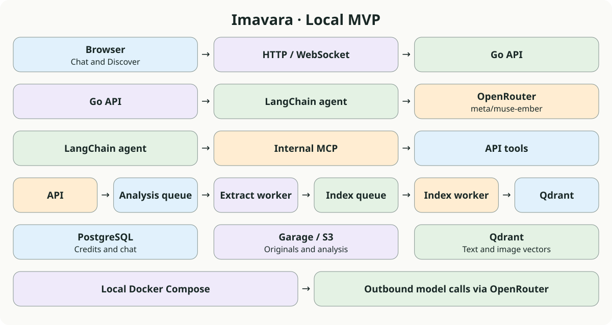
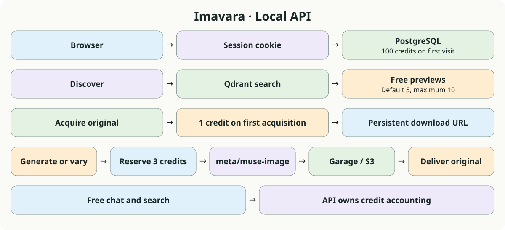
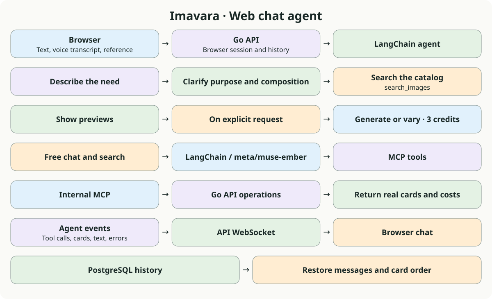
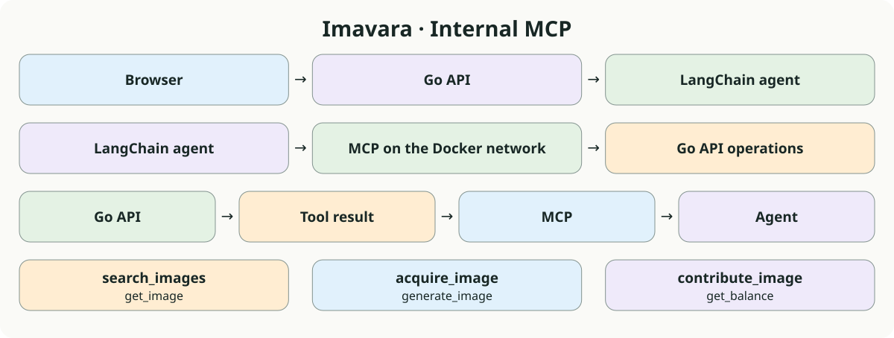
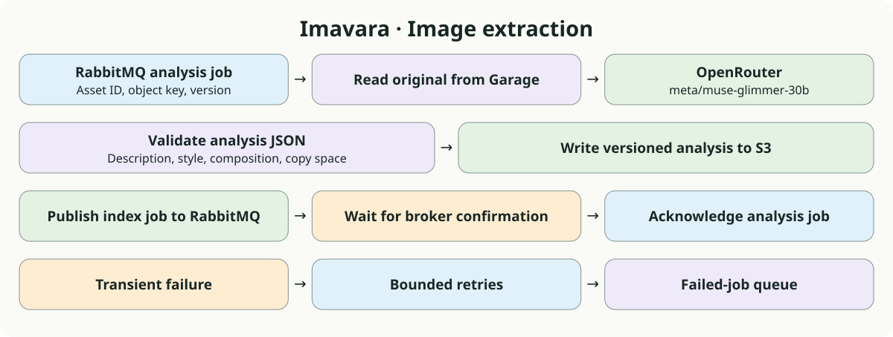
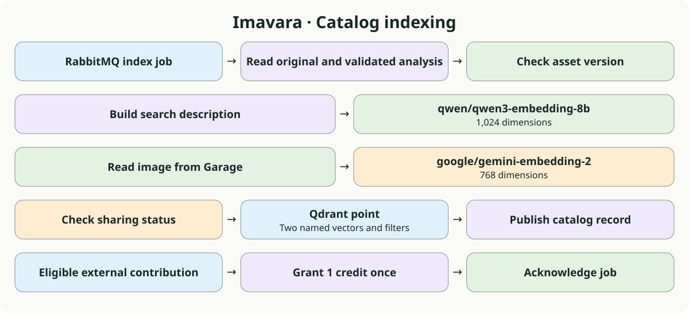

# Imavara Server

Imavara searches a shared stock photo catalog from a visual brief. Users can acquire an existing photo, generate a new one, or request a variation of a specific result. This repository runs the browser API, chat agent, and services that publish generated images to the catalog. [React client](https://github.com/ekremrn/imavara-web)

## Architecture



**Search.** Discover calls the API directly. In chat, the LangChain agent uses internal MCP to call the same operations. The API searches Qdrant by text or reference image. Optional `top_k` accepts 1–10 and defaults to 5. Results carry similarity scores.

**Generation and publication.** The API saves the original to Garage and delivers it to the requester. Generated images and variations enter catalog review automatically. The extraction worker processes RabbitMQ jobs and describes accepted images. The index worker writes text and image vectors to one Qdrant point. Once published, the image is available in shared search. PostgreSQL stores browser sessions, conversations, and the credit ledger.

### Service flows

<details>
<summary>Go API · Sessions, search, generation, and delivery</summary>



</details>

<details>
<summary>Web agent · From conversation to tool call</summary>



</details>

<details>
<summary>Internal MCP · From tool call to API operation</summary>



</details>

<details>
<summary>Extraction worker · From pixels to structured descriptions</summary>



</details>

<details>
<summary>Index worker · From analysis to a searchable record</summary>



</details>

## Local setup

Install Docker Engine and Compose. From the repository root, create the environment file on first setup:

```sh
cp .env.example .env
```

Set `OPENROUTER_API_KEY` for model calls. Sentry is optional locally. Start the services and check readiness:

```sh
docker compose up -d --build
docker compose ps -a
curl -fsS http://127.0.0.1:18080/healthz
```

The one-shot `garage-init` and `catalog-init` containers exit with code zero after setup. A new Qdrant installation uses one node, one volume, 16 shards, and replication factor 1.

| Local endpoint | Purpose |
| --- | --- |
| [API health](http://127.0.0.1:18080/healthz) | Check API readiness |
| [Grafana](http://127.0.0.1:13000) | Inspect service metrics from Prometheus |
| [RabbitMQ](http://127.0.0.1:15672) | Inspect extraction and indexing queues |

## Testing and operations

Follow logs with `docker compose logs -f api image-extract-worker index-worker`. Stop the stack with `docker compose down` to retain the volumes.

Run `go test ./...` for Go packages. To exercise credit concurrency, point `IMAVARA_TEST_DATABASE_URL` at an empty disposable PostgreSQL database. The test applies migrations and writes records.

Jobs that repeatedly fail remain in their failure queue after three attempts. After fixing the cause, run `docker compose exec image-extract-worker replay -queue assets.extract.v1 -limit 1` to retry one extraction. Use `assets.index.v1` for indexing. Replay acknowledges the failed delivery after broker confirmation.

For a Qdrant backup, pause indexing writes and run `docker compose exec index-worker snapshot`. The snapshot and manifest go into Garage's private snapshots bucket. Run `docker compose exec index-worker snapshot -id BACKUP_ID -restore-to NEW_COLLECTION` to restore into an unused collection. The command checks the point count and searches for a known image.

**Migrating the old two-node deployment.** The new `qdrant_data` volume starts with an empty 16-shard collection. Pause indexing writes and export the original point IDs, both vectors, and payloads before migrating. Import them with the same IDs to preserve PostgreSQL associations. Verify counts and known searches before retiring the old volumes. Restore older two-part snapshots using their original topology.

## Project documentation

[Product and architecture](docs/IMAVARA-MVP.md) · [Service tasks](docs/SERVICE-TASKS.md) · [Delivery and acceptance](docs/DELIVERY-PLAN.md) · [Development guide](AGENTS.md) · [Changelog](CHANGELOG.md)
