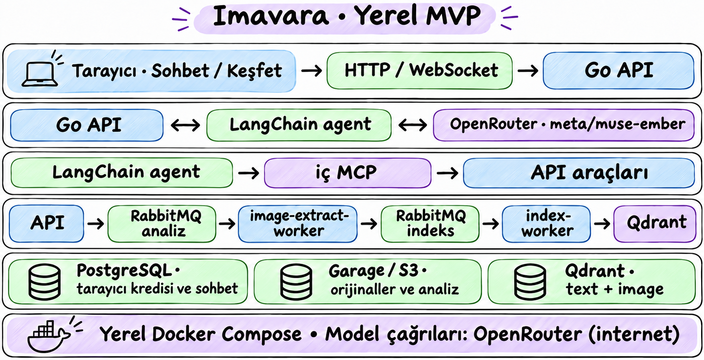
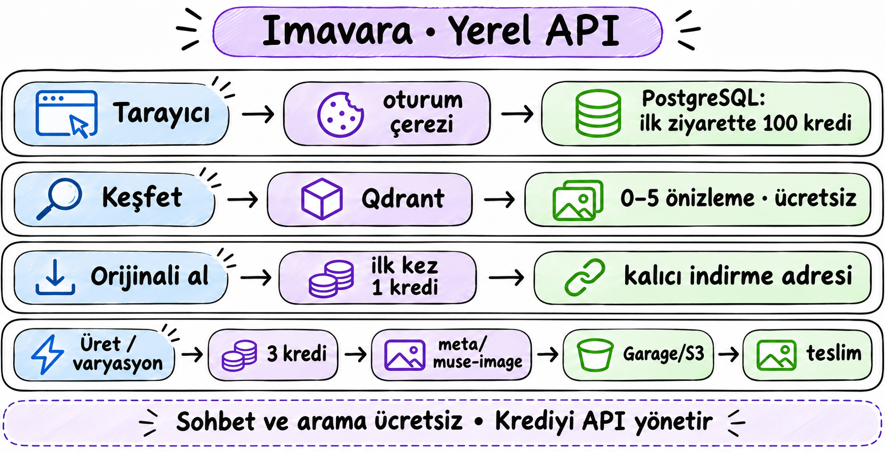
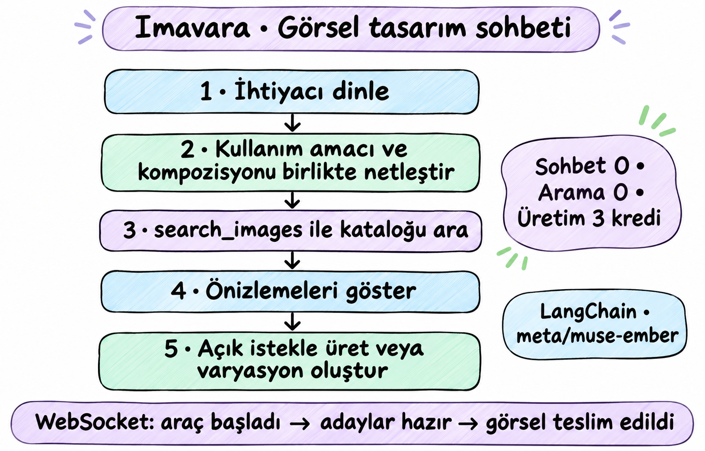
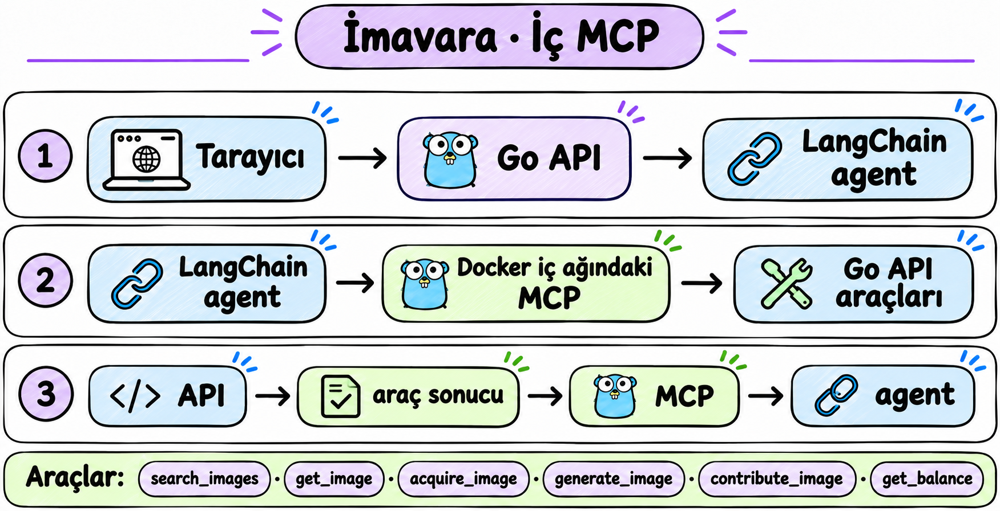
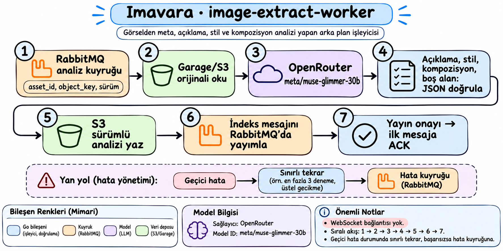
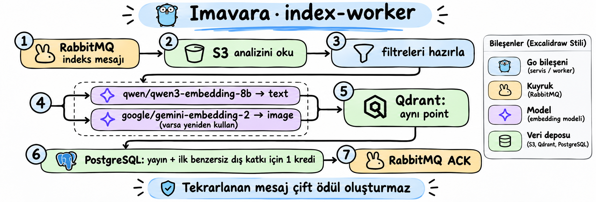

# Imavara Server

Imavara, bir görsel tarifini ortak fotoğraf kataloğunda arar. Kullanıcı mevcut bir görseli edinebilir, yeni bir fotoğraf üretebilir veya seçtiği görselden varyasyon isteyebilir. Bu repo, tarayıcıya hizmet veren API’yi, sohbet agent’ını ve üretilen görselleri kataloğa kazandıran servisleri içerir. [React arayüzü](https://github.com/ekremrn/imavara-web)

## Sistem nasıl çalışır?



**Arama.** Keşfet doğrudan API’ye gider. Sohbette aynı işlemi LangChain agent’ı iç ağdaki MCP üzerinden çağırır. API metin veya referans görseliyle Qdrant’ta arar. `top_k` varsayılan olarak 5’tir ve 1–10 arasında seçilebilir. Yanıt, bulunan kartlarla birlikte benzerlik skorlarını taşır.

**Üretim ve yayım.** API üretilen orijinali Garage’a kaydeder ve kullanıcıya teslim eder. Üretim ve varyasyonlar otomatik olarak katalog değerlendirmesine girer. RabbitMQ üzerinden çalışan analiz worker’ı kabul edilen görselin açıklamasını ve niteliklerini çıkarır. İndeks worker’ı metin ve görsel vektörlerini aynı Qdrant kaydına yazınca fotoğraf ortak aramada görünür. PostgreSQL tarayıcı oturumlarını, sohbetleri ve kredi hareketlerini tutar.

### Servis akışları

<details>
<summary>Go API · Oturum, arama, üretim ve dosya teslimi</summary>



</details>

<details>
<summary>Web agent · Sohbetten araç çağrısına</summary>



</details>

<details>
<summary>İç MCP · Araç çağrısından API işlemine</summary>



</details>

<details>
<summary>Analiz worker’ı · Görselden yapılandırılmış açıklamaya</summary>



</details>

<details>
<summary>İndeks worker’ı · Analizden aranabilir kayda</summary>



</details>

## Yerel kurulum

Docker Engine ve Compose ile repo kökünde başla. İlk kurulumda ortam dosyasını oluştur:

```sh
cp .env.example .env
```

Model çağrıları için `.env` içinde `OPENROUTER_API_KEY` tanımla. Sentry yerelde isteğe bağlıdır. Ardından servisleri başlat:

```sh
docker compose up -d --build
docker compose ps -a
curl -fsS http://127.0.0.1:18080/healthz
```

`garage-init` ve `catalog-init` kurulumları tamamlandığında sıfır çıkış koduyla kapanır. Yeni Qdrant kurulumu tek node, tek veri volume’ü, 16 shard ve replika faktörü 1 kullanır.

| Yerel adres | Kullanım |
| --- | --- |
| [API sağlık kontrolü](http://127.0.0.1:18080/healthz) | API’nin hazır olduğunu doğrulama |
| [Grafana](http://127.0.0.1:13000) | Servislerin Prometheus metriklerini izleme |
| [RabbitMQ](http://127.0.0.1:15672) | Analiz ve indeks kuyruklarını inceleme |

## Test ve işletim

Servis loglarını `docker compose logs -f api image-extract-worker index-worker` ile izle. `docker compose down` kalıcı diskleri korur.

Go paket kontrolleri için `go test ./...` çalıştır. Kredi eşzamanlılığı testi için boş, geçici PostgreSQL bağlantısını `IMAVARA_TEST_DATABASE_URL` ile belirt. Test bu veritabanına migration uygular ve test kayıtları yazar.

Sürekli hatalı işler üç denemeden sonra ilgili hata kuyruğunda kalır. Nedeni düzelttikten sonra `docker compose exec image-extract-worker replay -queue assets.extract.v1 -limit 1` ile tek bir işi yeniden dene. İndeks işleri için `assets.index.v1` kullan. Komut yalnız broker onayından sonra hata kuyruğundaki kopyayı kapatır.

Qdrant yedeği için indeks yazımlarının durduğu bir anda `docker compose exec index-worker snapshot` çalıştır. Tek node’un snapshot dosyası ve manifest Garage’ın özel snapshots bucket’ına yazılır. Çıkan kimliği `docker compose exec index-worker snapshot -id KIMLIK -restore-to YENI_KOLEKSIYON` ile kullan. Komut mevcut koleksiyonu korur, kurtarılan point sayısını ve bilinen bir referansla aramayı kontrol eder.

Eski iki node’lu kurulumdan geçerken yeni `qdrant_data` volume’ü boş bir 16 shard koleksiyonuyla başlar. Mevcut katalog ve PostgreSQL kayıtlarını birlikte kullanmaya devam etmek için geçişten önce indeks yazımlarını durdur, eski koleksiyonun point kimliklerini, iki vektörünü ve payload’larını dışa aktar. Yeni koleksiyona aynı kimliklerle yükle, point sayısını ve bilinen aramaları doğrula. Eski volume’leri geçiş doğrulanana kadar sakla. Önceki iki parçalı snapshot eski topolojiyle geri yüklenir.

## Proje belgeleri

[Ürün ve mimari planı](docs/IMAVARA-MVP.md) · [Servis görevleri](docs/MVP-SERVIS-GOREVLERI.md) · [Teslim kriterleri](docs/MVP-TESLIM-PLANI.md) · [Geliştirme rehberi](AGENTS.md) · [Değişiklik geçmişi](CHANGELOG.md)
